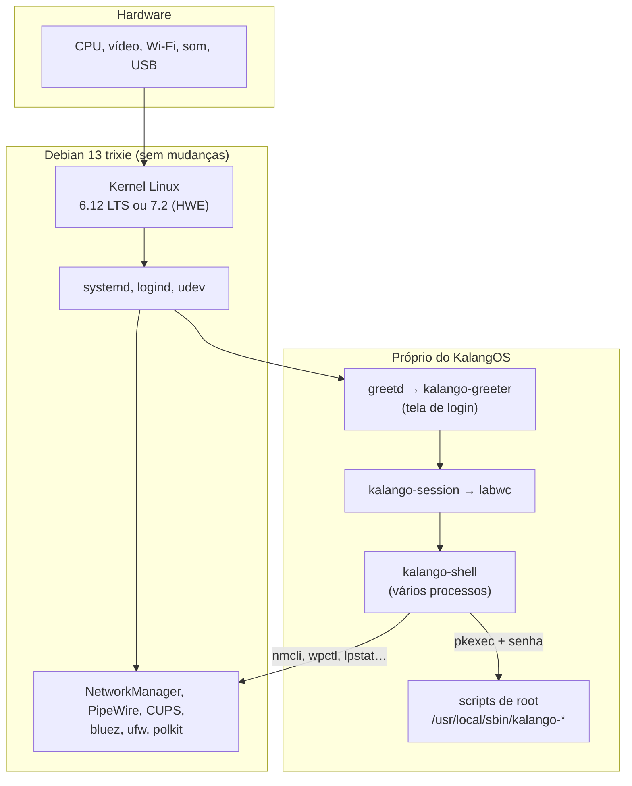

# Arquitetura

O KalangOS é o Debian 13 com uma interface própria por cima. Esta página mostra
o caminho do boot até a área de trabalho e por que a interface é dividida em
vários processos.

## Camadas

- **Tudo abaixo da linha "Próprio do KalangOS" é Debian sem alteração.** Por
  isso o sistema recebe as correções de segurança do Debian pelo apt
  normalmente, e o projeto só precisa manter a camada de cima.
- A interface não fala com o hardware diretamente. Ela chama os programas
  padrão do Linux (`nmcli` para rede, `wpctl` para som, `lpstat` para
  impressoras, `bluetoothctl`…) e lê o `/sys` e o `/proc`.

## Do boot à área de trabalho

1. **GRUB** (com o tema do KalangOS) carrega o kernel.
2. **systemd** sobe os serviços. O `greetd` abre o `kalango-greeter`: um labwc
   com configuração própria rodando `kalango-shell --greeter` (a tela de login,
   `src/shell/greeter.rs`), como o usuário de sistema `_greetd`.
3. A senha vai do greeter para o greetd por um socket, e o greetd a confere no
   **PAM** (o mesmo mecanismo de login de todo Linux). O PIN também passa pelo
   PAM (`kalango-pin`).
4. Senha certa: o greetd inicia `kalango-session` com a conta da pessoa. Esse
   script prepara o ambiente (idioma, teclado, Flatpak, sessão pelo logind) e
   executa o **labwc**.
5. O labwc roda o seu *autostart*, que abre o **supervisor**
   `kalango-shell-sessao`. Ele abre a área de trabalho (`kalango-shell` sem
   argumento) e a reabre se cair. Se cair 3 vezes seguidas, volta para a
   versão anterior do shell.

## Por que a interface tem vários processos

O jeito "certo" de fazer barra e dock no Wayland é um protocolo chamado
*layer-shell*. A biblioteca de janelas que o Slint usa (winit) não tem suporte a
ele. A solução foi rodar o **mesmo binário** várias vezes, cada uma como uma
janela com regras próprias no labwc (`distro/config/includes.chroot/etc/xdg/labwc/rc.xml`):

| Processo | Argumento | Janela | Arquivo principal |
|---|---|---|---|
| Área de trabalho | (nenhum) | tela cheia, sempre atrás de tudo: fundo, barra, ícones | `src/lib.rs`, `src/shell/session.rs` |
| Dock | `--dock` | sempre por cima, encostada na borda | `src/shell/dock.rs` |
| Faixa da dock escondida | `--dock-gatilho` | faixa de 2 px na borda | `src/shell/dock.rs` |
| Menu de apps | `--launcher` | tela cheia transparente, por cima | `src/launcher/` |
| Painel rápido | `--quick-settings` | tela cheia transparente, por cima | `ui/screens/quick_settings.slint` |
| Calendário | `--calendario` | tela cheia transparente | `src/shell/calendar.rs` |
| Configurações | `--settings` | janela comum com moldura própria | `src/settings/` |
| Calculadora | `--calculadora` | janela comum | `src/tools/` |
| Alt+Tab | `--alternar` | processo fixo, janela só no Alt+Tab | `src/shell/switcher.rs` |
| Menu da dock | `--menu-dock=` | tela cheia transparente | `src/shell/taskbar.rs` |
| Captura de tela | `--captura` | tela cheia transparente | `src/shell/capture.rs` |
| Aviso de volume | `--osd=` | camada layer-shell própria, sem winit | `src/shell/osd.rs` |
| Fundo de monitor extra | `--fundo=` | tela cheia atrás, um por monitor | `src/shell/outputs.rs` |
| Tela de login | `--greeter` | tela cheia, só no greeter | `src/shell/greeter.rs` |

O modo é escolhido em `Mode::from_args` (`src/shell/session.rs`). Abrir um modo
que já está aberto (menu, painel) **fecha** o que estava aberto: por isso a tecla
Super abre e fecha o menu. O controle é um arquivo de PID em `$XDG_RUNTIME_DIR`.

### Como os processos conversam

Não há servidor central. Cada processo lê e grava arquivos pequenos:

| Arquivo | Quem grava | Quem lê | Para quê |
|---|---|---|---|
| `~/.config/kalango/aparencia.conf` | Configurações | todos (a cada < 1 s) | tema, cores, dock, papel de parede |
| `~/.config/labwc/rc.xml` | área de trabalho | labwc | margens da dock, atalhos, regras de janela |
| `$XDG_RUNTIME_DIR/kalango-aviso` | captura, teclas de mídia | área de trabalho | aviso no centro da barra |
| `$XDG_RUNTIME_DIR/kalango-settings.pagina` | menu da área de trabalho | Configurações abertas | abrir numa página |
| sockets `kalango-alternar.sock`, `kalango-osd.sock` | atalhos | Alt+Tab, aviso de volume | pedidos rápidos |

## Modo real e protótipo

O mesmo código roda de dois jeitos:

- **Sessão real** (`KALANGO_SESSION=1`, exportado pelo `kalango-session`): abre
  apps de verdade, desliga o computador, mexe no sistema.
- **Protótipo** (sem a variável, por exemplo `cargo run` no seu computador de
  desenvolvimento): mostra telas de demonstração e não toca no sistema. É o que
  o `examples/snapshot.rs` usa para gerar imagens no CI.

`session::is_native()` decide. Ele também exige que o binário se chame
`kalango-shell` ou `kalango_os`: um exemplo ou teste rodado dentro da sessão não
consegue se passar pela área de trabalho (isso já causou uma cascata de
processos e travou a máquina).

## Wayland, X11 e o labwc

- O labwc é a versão 0.8 do Debian. Várias limitações dele moldaram o código e
  estão anotadas onde aparecem: ele não respeita o tamanho pedido pela janela da
  dock (por isso a regra no `rc.xml` com tamanho e posição), não recalcula a
  área útil ao mudar a margem (por isso o `wlr-randr --on` em
  `labwc::refit_maximized_later`), lê um só `environment` e um só `menu.xml`.
- **Nunca escreva `--` dentro de um comentário `<!-- -->` no `rc.xml`**: o XML
  fica inválido e o labwc ignora as regras seguintes sem avisar. Há um teste
  (`labwc::rc_xml_gerado_e_bem_formado`) que confere.
- Programas X11 (VS Code, jogos pelo Proton, Steam) rodam pelo Xwayland. O shell
  conhece as janelas pelo protocolo `wlr-foreign-toplevel` (`src/shell/toplevels.rs`),
  que vê as duas.
