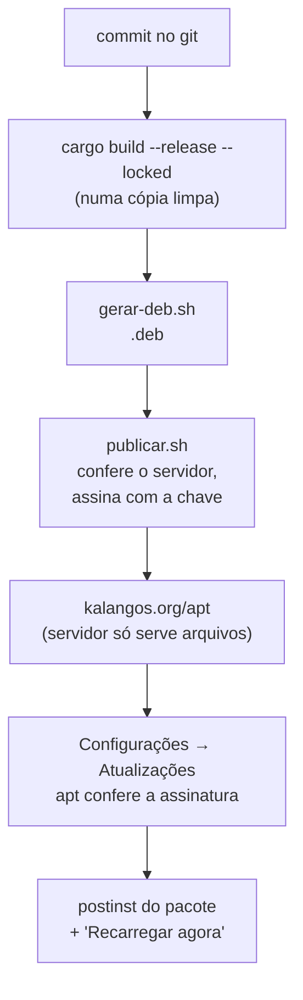

# Pacotes e atualizações

Como uma mudança no código chega ao computador de quem usa o KalangOS.

## Os pacotes do projeto

| Pacote | Arquitetura | Conteúdo | Gerado por |
|---|---|---|---|
| `kalango-shell` | amd64 | o binário, os scripts de `/usr/local`, políticas do polkit, temas do terminal, `.desktop` próprios | `distro/pacotes/gerar-deb.sh` |
| `kalango-papeis-de-parede` | all | papéis de parede em foto (JPEG, ~30 MB) | `distro/pacotes/gerar-deb-papeis.sh` |

O `kalango-shell` depende do pacote de papéis de parede. Eles são separados para
que uma correção na interface (~10 MB) não faça ninguém baixar as fotos de novo.

**Versões:**

- `kalango-shell`: `<versão do Cargo.toml>-<revisão>`, por exemplo `0.1.1-17`. A
  revisão sobe a cada publicação (`KALANGO_REVISAO=17`).
- `kalango-papeis-de-parede`: `AAAA.MM.DD-N`, escrita no próprio script. Só sobe
  quando as fotos mudam. O pacote é **reprodutível**: a mesma versão gera o mesmo
  arquivo byte a byte.

**Notas da versão:** `distro/pacotes/novidades` (uma linha por novidade, em
português e inglês). O `gerar-deb.sh` as põe na descrição do pacote, e a página
Atualizações as mostra antes de instalar. **Troque o texto a cada versão.**

## O caminho de uma atualização

1. **Compile a partir de uma cópia limpa do commit** (`git worktree add`), não da
   pasta de trabalho: assim nada que ainda não foi revisado entra no pacote.
2. `KALANGO_REVISAO=N distro/pacotes/gerar-deb.sh <binário> <pasta>`.
3. `distro/repo/publicar.sh <pacotes .deb>` (variáveis em `distro/repo/LEIAME.md`).
   Antes de assinar, ele **confere** cada pacote que já está no servidor contra o
   índice que você assinou da última vez; qualquer arquivo estranho interrompe
   tudo. Depois assina (`InRelease`, `Release.gpg`) e envia por `rsync`.
4. Nos computadores, a página Atualizações roda `kalango-atualizar procurar` e
   `instalar` (que é `apt-get full-upgrade`). O apt só aceita o que tiver a
   assinatura da chave do projeto (`Signed-By` em
   `/etc/apt/sources.list.d/kalango.sources`).
5. O pacote é instalado. A área de trabalho percebe que o binário mudou e
   pergunta "Recarregar agora". Não precisa reiniciar.

## Rede de segurança na atualização

- O **preinst** guarda o binário em uso em `/var/lib/kalango/shell-anterior`.
- O **supervisor** (`kalango-shell-sessao`) volta para ele se a versão nova cair
  3 vezes em menos de 30 s, e avisa.
- Atualização **não muda o visual** de quem já usa: opção nova de aparência
  entra em `appearance::LEGACY` com o valor antigo.
- **Integridade:** a área de trabalho compara os arquivos do pacote com o
  `md5sums` do dpkg e avisa se algo mudou fora do apt (copiar um binário à mão
  dispara o aviso; é esperado).

## O repositório apt

- Endereço: `https://kalangos.org/apt` (o antigo `kalangos.easysmartcontroll.com/apt`
  serve os mesmos arquivos).
- Chave: `0B89DC19D08F8A6B` (ed25519, vale até 2036). A pública vai na ISO em
  `/usr/share/keyrings/kalango-archive-keyring.gpg`.
- **A chave privada fica só no computador do mantenedor.** Perder a chave
  significa que os sistemas instalados não aceitam mais atualizações (seria
  preciso uma ISO nova com outra chave). Vazar a chave significa que qualquer um
  pode publicar uma atualização que roda como root em todas as máquinas. Veja
  [Segurança](seguranca.md#a-chave-do-repositório).
- O servidor só serve arquivos estáticos (nginx). Ele **não** tem a chave.

## Pacotes do Debian

Tudo o mais vem do Debian 13 e é atualizado pelo próprio apt do Debian
(correções de segurança em `trixie-security`). O projeto não recompila nem altera
pacotes do Debian.

Dependências do `kalango-shell` (em `gerar-deb.sh`):

- `Depends:` o que a interface precisa para funcionar (labwc, foot, zsh, grim,
  wf-recorder, wl-clipboard, ufw, playerctl, brightnessctl, ptyxis, o pacote de
  papéis de parede).
- `Recommends:` o que melhora a experiência e o apt instala junto na atualização
  (sons do sistema, `steam-devices`, Shotwell, Celluloid).

Acrescentar uma dependência faz o apt **instalar esse pacote em todos os
computadores** na próxima atualização. Prefira `Recommends` para o que não é
essencial.

## Flatpak

A Loja (GNOME Software) instala apps do Flathub. Eles se atualizam pela própria
Loja e pela página Atualizações, separados do apt.
