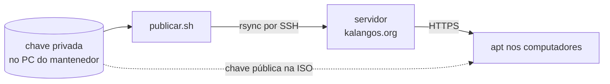

# Segurança

O que proteger, onde estão os riscos e as regras para não criar vulnerabilidades.
Para relatar uma falha, veja `SECURITY.md`.

## O que estamos protegendo

O bem mais valioso não é este repositório: são **os computadores de quem instala o
KalangOS**. O pacote `kalango-shell` roda scripts como root na instalação e é
atualizado automaticamente. Quem conseguir publicar um pacote falso controla todas
essas máquinas. Por isso a ordem de prioridade é:

1. **A cadeia de atualização:** chave, servidor e script de publicação.
2. **O que roda como root:** os scripts de `/usr/local/sbin` e o PAM.
3. **A interface:** comandos montados com dados de fora (nomes de arquivo, de
   redes Wi-Fi, de impressoras…).
4. **As dependências:** crates do Rust e arquivos baixados no build da ISO.

## A cadeia de atualização



O apt dos computadores só aceita índices assinados pela chave do projeto. Então:

| Se alguém… | Consegue | Proteção |
|---|---|---|
| invadir o **servidor** | apagar, trocar a ISO, servir índice antigo | não consegue assinar; o `publicar.sh` recusa pacotes que não foram assinados antes |
| roubar a **chave privada** | publicar atualização maliciosa para todos | chave com senha, fora de backups abertos, só no PC do mantenedor |
| controlar o **DNS** | apontar para outro servidor | HTTPS + assinatura |
| trocar a **ISO** no site | quem baixar instala a ISO falsa | hoje só o `.sha256` no mesmo servidor (ver pendências) |

### A chave do repositório

- Fica em `~/.local/share/kalango-repo/gnupg` (no desktop do mantenedor, em
  `~/Documents/.local/share/kalango-repo`). **Nunca** vai para o git.
- **Ponha senha na chave:** `gpg --homedir <pasta>/gnupg --passwd 0B89DC19D08F8A6B`.
  Sem senha, qualquer programa rodando na sua conta (uma extensão do editor, um
  pacote do npm, um script baixado) consegue assinar uma atualização.
- Guarde uma cópia **criptografada e fora do computador** (pendrive guardado,
  cofre de senhas). Perder a chave obriga a lançar uma ISO nova com outra chave.
- Backups da pasta pessoal levam a chave junto: mantenha o arquivo de backup com
  `chmod 600` e, de preferência, criptografado.

### O servidor

- SSH **só com chave** (`PasswordAuthentication no`, `PermitRootLogin
  prohibit-password`); confira com `sshd -T`. O arquivo
  `/etc/ssh/sshd_config.d/50-cloud-init.conf` do provedor ligava a senha de volta.
- O painel aaPanel só pela VPN.
- O servidor tem outros sites, que rodam como o mesmo usuário `www` dono da pasta
  do apt. Uma falha em qualquer um deles dá acesso a essa pasta. O `publicar.sh`
  foi feito para isso não virar um pacote assinado.
- O FTP (porta 21) manda senha sem criptografia: desligue se não usar.

### O `publicar.sh`

Antes de assinar, ele baixa o índice e os pacotes do servidor numa quarentena e
confere que cada `.deb` tem o SHA-256 listado num índice **assinado pela chave do
projeto**. Pacote desconhecido ou alterado, índice de outra chave, servidor
inacessível: para tudo antes de assinar. Se isso acontecer, **não force**:
investigue o servidor.

## Scripts que rodam como root

Toda mudança em `/usr/local/sbin/kalango-*` ou no PAM deve seguir estas regras:

1. **Valide toda entrada.** Os argumentos vêm de uma conta comum (pelo `pkexec`).
   Recuse caracteres de controle (quebra de linha, tab) em nomes de pasta, de
   conta, de impressora: eles já permitiram injetar configuração no Samba
   (corrigido na 0.1.1-6).
2. **Confira de quem é a coisa.** Ex.: o compartilhamento só aceita pastas dentro
   da casa de quem chamou (`$PKEXEC_UID`), nunca do root ou de outra conta.
3. **Arquivo gravado como root em pasta onde outros escrevem nunca segue link**
   (`O_NOFOLLOW`, ou crie com `mktemp` e mova). Senão uma conta comum aponta o
   link para o `/etc/shadow`.
4. **Senhas pela entrada padrão (stdin), nunca como argumento.** Argumentos
   aparecem no `ps` para qualquer conta.
5. **Aspas em todas as variáveis** (`"$var"`) e `set -eu` no começo.
6. **Mínimo necessário:** o script faz uma coisa e recusa qualquer outro verbo.
7. Política do polkit com `auth_admin` ou `auth_admin_keep`. Nunca `yes` para uma
   ação que mude o sistema.
8. Teste o caso malicioso, não só o normal (nome com `../`, com quebra de linha,
   com link simbólico).

## Regras para o código Rust

- **Sem `unsafe`.** Hoje não há nenhum.
- **Comando com argumentos separados**, sempre:
  ```rust
  Command::new("nmcli").args(["connection", "up", "id", &nome])   // certo
  Command::new("sh").args(["-c", &format!("nmcli ... {nome}")])   // NUNCA
  ```
  `sh -c` só com texto fixo do próprio código. Os usos atuais (esvaziar a
  lixeira em `trash.rs`, senha do Samba em `sharing.rs`, atualizações pelo
  terminal em `session.rs`, `script -c passwd` em `users.rs`) só levam textos
  fixos e o nome da própria conta. Confira com `grep -rn '"-c"' src`.
- Texto que vem de fora (nome de rede Wi-Fi, de arquivo, de app) e que vai para um
  arquivo de configuração precisa ser **escapado** no formato daquele arquivo. Ex.:
  `shortcuts::apply` escapa `&`, `<`, `>`, `"` antes de pôr o comando no XML do
  labwc.
- Leia a saída de comandos com `LC_ALL=C` quando a lógica depender do texto.
- `--locked` em todo build de pacote.

## Dependências

### Crates do Rust

O `Cargo.lock` tem ~540 pacotes. Para saber se algum tem falha conhecida:

```sh
cargo install cargo-audit cargo-deny
cargo audit          # compara o Cargo.lock com o banco RustSec de vulnerabilidades
cargo deny check     # licenças, crates repetidas, origem (precisa de um deny.toml)
```

Hoje **nenhum dos dois está instalado nem roda no CI**: é a melhoria de maior
retorno. Rode `cargo audit` antes de cada versão.

Atualizar crates: `cargo update` (dentro das versões permitidas no `Cargo.toml`),
depois `cargo test`, `cargo clippy` e teste visual na VM. Leia o changelog do
Slint antes de subir a versão dele.

### Arquivos baixados no build da ISO

Temas de ícones, módulo do gtklock e Flathub são baixados de terceiros. Todos têm
**versão (tag ou commit) e SHA-256 fixos** no script que baixa. Ao atualizar,
confira o código novo e só então troque a soma. Nunca troque a soma "porque o
download falhou".

### Pacotes do Debian

Vêm assinados pelo Debian e recebem correções pelo `trixie-security`. Nada a fazer
além de não desligar o repositório de segurança.

## Segredos no repositório

- Nunca entram no git: chave do apt, chave SSH, senhas, IPs e acessos do servidor
  (estes ficam em `CLAUDE.local.md`, que está no `.gitignore`).
- O histórico tem IPs internos (`10.8.0.1`, `192.168.1.x`) em documentação antiga.
  Não são segredos, mas revelam a rede. Antes de tornar o repositório público,
  rode `gitleaks detect` no histórico inteiro.
- Os testes usam chaves WireGuard de exemplo; confira que nenhuma é de verdade.

## GitHub e CI

- O CI (`.github/workflows/ci.yml`) roda em pull requests com permissão só de
  leitura e sem segredos: código de fora não consegue publicar nada.
- Releases só por tag `v*`, que só o mantenedor cria.
- As actions estão por tag (`actions/checkout@v4`). Fixar por commit (SHA) protege
  contra uma action comprometida.

## Pendências conhecidas

| Pendência | Risco | Como resolver |
|---|---|---|
| Chave do apt sem senha | alto | `gpg --passwd` |
| Backup da pasta pessoal legível por todos, com a chave do apt e a chave SSH | alto | `chmod 600`, criptografar |
| `cargo audit` fora do CI | médio | instalar e pôr no `ci.yml` |
| ISO sem assinatura (só `.sha256` no mesmo servidor) | médio | publicar `SHA256SUMS` assinado com a chave do projeto e a impressão digital no site |
| `Release` do apt sem `Valid-Until` | médio | permite "congelar" atualizações; pôr ~30 dias no `publicar.sh` e republicar todo mês |
| Senha do Wi-Fi/VPN e chave do WireGuard como argumento do `nmcli` (visível no `ps` por ~1 s) | baixo | passar por arquivo temporário ou stdin |
| Scripts de shell sem análise automática | baixo | `shellcheck distro/config/includes.chroot/usr/local/*/*` no CI |
| `gitleaks` no histórico antes de abrir o repositório | — | rodar uma vez |
| FTP aberto no servidor | médio | desligar se não usar |

## Se algo der errado

- **Pacote estranho no servidor** (o `publicar.sh` acusou): não publique. Veja
  quando e por quem o arquivo foi criado, apague, mude as senhas do servidor e
  revise os outros sites.
- **Chave do apt vazou:** gere outra (`distro/repo/criar-chave.sh`), lance uma
  versão assinada com a antiga que instala a nova chave e retira a antiga, depois
  uma ISO nova. Avise no site.
- **Falha num script de root:** corrija, suba a revisão, publique e escreva nas
  novidades "correção de segurança".
